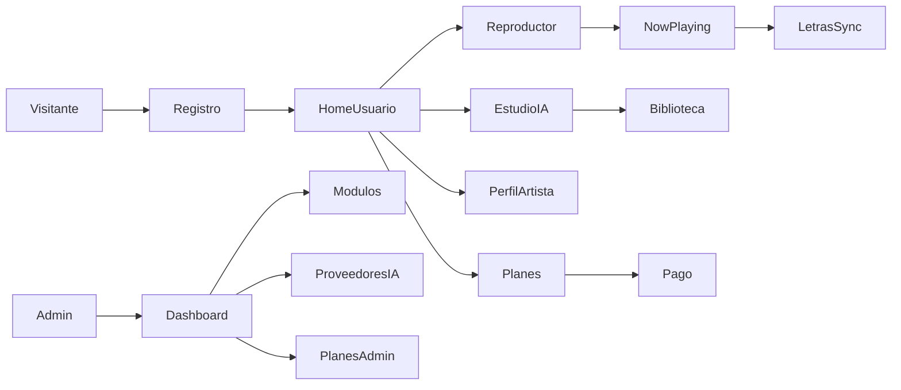

# Plataforma musical con IA estilo Spotify (fases 1 a 5)

## Visión general
Una plataforma web completa con cuentas de usuario, donde la gente escucha música, crea canciones, videos e imágenes con IA, y los artistas tienen su perfil público. Los administradores la gestionan desde un panel empresarial con planes de pago. Funciona sola con Cloud Backend. Cada función está hecha como un **módulo independiente** (el equivalente a un "plugin"): se puede activar o desactivar desde el panel, y así será fácil conectarla a WordPress más adelante.

**Estilo visual:** tema oscuro tipo Spotify, con un color de acento vivo (verde lima eléctrico), barra lateral fija, reproductor fijo abajo, portadas grandes y tipografía sans moderna. Las portadas, banners de artistas y fondos se generan con IA, todos con la misma dirección de arte.

---

## Fase 1 — Cuentas, Home y reproductor
- **Registro / login**, recuperar contraseña, perfil de usuario y roles (oyente, artista, administrador).
- **Home estilo Spotify:** saludo, "escuchado recientemente", playlists destacadas, nuevos lanzamientos, artistas populares, búsqueda.
- **Biblioteca:** canciones con "me gusta", playlists propias (crear, editar, reordenar).
- **Reproductor fijo abajo:** reproducir/pausar, siguiente/anterior, aleatorio, repetir, barra de progreso, volumen y cola de reproducción.
- **Now Playing a pantalla completa:** portada grande, fondo con el color de la portada, controles e información del artista.
- **Letras sincronizadas:** la línea actual se resalta y se desplaza sola al ritmo de la canción; al tocar una línea, la canción salta a ese momento. Los artistas suben letras en formato con marcas de tiempo (LRC) o las sincronizan con un editor de "tap" mientras escuchan.

## Fase 2 — Perfil de artista
- Página pública con banner, foto, biografía, oyentes mensuales, canciones populares, álbumes, enlaces sociales y botón de seguir.
- **Panel del artista:** subir canciones y portadas, crear álbumes, editar letras y ver estadísticas básicas (reproducciones y seguidores).

## Fase 3 — Estudio de IA (música, videos, imágenes)
- Tres pestañas: **Música**, **Video** e **Imagen**. Cada una tiene un cuadro de texto (prompt), opciones de estilo, duración o tamaño, y una galería con los resultados.
- Seguimiento del estado de cada creación (en cola, generando, lista, error).
- Lo que crea el usuario se guarda en su biblioteca; las canciones se pueden publicar directamente en su perfil de artista y escuchar en el reproductor.
- Cada creación descuenta **créditos** según el plan del usuario.

## Fase 4 — Proveedores de IA externos
- En el panel de administración, una sección **Proveedores de IA** donde se registran los proveedores (por ejemplo: OpenAI, Replicate, ElevenLabs, Suno, Runway, Stability) y se elige qué proveedor usa cada tipo de creación.
- Las claves de API se guardan de forma segura como secretos del servidor, nunca en la página ni en la base de datos. Todas las llamadas a la IA pasan por funciones del servidor.
- Cada proveedor es un módulo propio: añadir uno nuevo no afecta a los demás.

## Fase 5 — Planes, pagos y dashboard empresarial
- **Página de planes** (por ejemplo: Gratis, Pro, Artista, Empresa) con precios mensuales o anuales, créditos de IA incluidos y funciones de cada plan.
- **Pago y suscripciones con Stripe:** checkout, renovación automática, cambio de plan, cancelación y portal de facturación. Los pagos se confirman desde el servidor mediante notificaciones verificadas de Stripe.
- **Dashboard administrativo:**
  - Métricas: usuarios, ingresos, suscripciones activas, reproducciones y creaciones con IA, con gráficos.
  - Gestión de usuarios y roles, artistas y moderación de contenido.
  - Creación y edición de planes y precios.
  - Proveedores de IA y uso de créditos.
  - **Módulos:** activar o desactivar Reproductor, Letras, Estudio de IA, Perfiles de artista y Pagos.

---

## Lo que necesitaré de ti durante el proceso
- Claves de API de los proveedores de IA que quieras usar (te las pediré de forma segura cuando lleguemos a la fase 3).
- Una cuenta de Stripe (clave secreta) para la fase 5.
- Al inicio cargaré canciones de demostración para que el reproductor y las letras se puedan probar de inmediato.

## Nota sobre WordPress
Aquí no puedo crear plugins de WordPress en PHP. La arquitectura en módulos está pensada para conectarse más adelante a tu sitio WordPress (usuarios, contenido o tienda), cuando quieras dar ese paso.

## Orden de construcción
Construiré **una fase por vez**, empezando por la Fase 1, para que puedas probar cada parte en la vista previa antes de seguir con la siguiente.